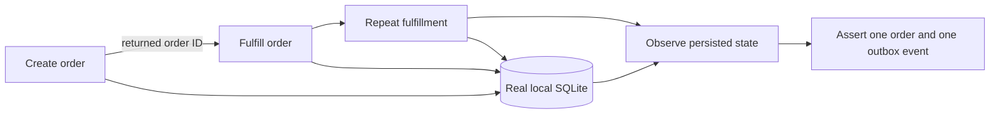

# Lambda Flow Lab

[](https://github.com/JagritGill/lambda-flow-lab/actions/workflows/ci.yml)

**Help an AI change the code without quietly changing what your product is
supposed to do.** Write reviewed workflow scenarios, replay them across Python
Lambda-style components, and compare evidence before and after a change.

The included example follows an order from creation through fulfillment to
persisted state. It catches a duplicate side effect even when every handler
still returns a successful response.

Version 0.1 is a small, original, MIT-licensed starting point. Python 3.11+;
no runtime dependencies, AWS account, Docker, model API key, or network access
needed for the tests. The AI feature exports a prompt for your chosen assistant;
it never calls a model or uploads your code.

## Try the full flow

From a clone of this repository:

```sh
python -m lambda_flow_lab validate examples/order_workflow/flows.json --project examples/order_workflow/project.json
python -m lambda_flow_lab run examples/order_workflow/flows.json --project examples/order_workflow/project.json --output artifacts/baseline.json
python scripts/regression_demo.py
```

The demo runs six scenarios, twenty steps, and forty-two assertions against real
temporary SQLite storage. It then copies the example into a temporary directory,
breaks fulfillment idempotency, and verifies that the unchanged tests catch it:

```text
baseline_status: passed
changed_status: failed
comparison_status: failed
failed check: duplicate_fulfillment / observe_state / /outbox:length
regression_caught: true
```

The demonstration exits `0` only when that expected regression is detected.
It does not edit the original example.



## After an AI changes your product

1. Describe approved behavior and synthetic fixtures in a contract. Keep expected
   behavior independent from the implementation being tested.
2. Export a local prompt: `python -m lambda_flow_lab prompt examples/order_workflow/contract.json --output artifacts/prompt.md`.
3. Review the prompt before giving it to your assistant. Review its proposed JSON
   scenarios and the separately controlled handler mapping before running them.
4. Capture a passing baseline on the working revision. Make the code change,
   replay the same scenarios, and compare:

```sh
python -m lambda_flow_lab run examples/order_workflow/flows.json --project examples/order_workflow/project.json --output artifacts/current.json
python -m lambda_flow_lab compare artifacts/baseline.json artifacts/current.json --output artifacts/comparison.json
```

Comparison fails for current failures, lost checks, rewritten expectations,
changed inputs/handler mappings, and inserted or reordered steps in an existing
flow. New passing scenarios and assertions are listed. Intentional contract
changes need review before replacing a baseline. Save the tested source revision
and dependency versions alongside reports; reports are not signed attestations.

See the [AI workflow](docs/ai-workflow.md) for the complete loop.

## What a scenario looks like

Project configuration controls the trusted Python callables:

```json
{"version":1,"handlers":{"create":"demo.orders:create","fulfill":"demo.fulfillment:fulfill","inspect":"demo.orders:inspect"}}
```

A flow sends the first component's result into the next and checks a separate
observation component:

```json
{
  "version": 1,
  "scenarios": [{
    "id": "fulfillment",
    "steps": [
      {"id":"create","handler":"create",
       "event":{"request_id":"synthetic-1","sku":"DEMO-BOOK","quantity":2},
       "expect":[{"path":"/status","equals":"created"}]},
      {"id":"process","handler":"fulfill",
       "event":{"order_id":{"$from":"create#/order_id"}},
       "expect":[{"path":"/status","equals":"fulfilled"}]},
      {"id":"observe","handler":"inspect","event":{},
       "expect":[{"path":"/orders/0/status","equals":"fulfilled"},
                 {"path":"/outbox","length":1}]}
    ]
  }]
}
```

Each scenario has fresh temporary state and a separate process. Steps share warm
module state within that process. References are data, never evaluated code.
Every step requires assertions. Failed steps stop their scenario; the remaining
scenarios continue. [Format reference](docs/scenario-format.md).

## What the evidence means

| Included | Outside v0.1 |
| --- | --- |
| Multi-step Python component flows and cross-step references | Browser/UI or HTTP transport execution |
| Actual local SQLite writes and observed outbox state | AWS runtime, API Gateway, SQS delivery, IAM, DynamoDB |
| Deterministic JSON assertions and baseline/coverage drift reporting | Automatic discovery of all requirements or regressions |
| Offline prompt export and strict candidate validation | Hosted AI generation, auto-healing assertions, source uploads |
| Scenario timeouts, fresh state, credential-free worker environment | Security sandboxing of untrusted application code |

Every report states `cloud_verified: false`. The example's persistence is real;
calling the next handler directly simulates delivery. The evidence label describes
the runner mode; an arbitrary pure function or mock supplies narrower evidence.
A green run cannot guarantee that nothing else broke.

Run only trusted code and dependencies. The Python network/process guard catches
common accidental calls; native code or direct system calls can bypass it.
Reports omit payloads, logs and exception text, but retain chosen identifiers and
definition hashes. Keep those identifiers non-sensitive.

`aws-plan` writes a **non-executable review checklist**. It does not deploy,
invoke AWS, discover credentials, or perform live end-to-end testing. Read the
[AWS boundary](docs/aws-boundary.md) before planning a separately approved cloud
adapter.

## Development

```sh
python -m unittest discover -s tests -v
python scripts/regression_demo.py
```

Optional installation from the checkout: `python -m pip install .` provides the
`lambda-flow-lab` command. Installation may download build tooling; running
directly from the checkout needs no installation. No PyPI publication is implied.

CI checks Python 3.11–3.13 on Linux and 3.13 on Windows, runs the regression demo,
builds the package, and uploads synthetic, payload-free evidence. GitHub Actions
and package build setup access their respective download services; the test
workflow itself does not use AWS or AI services. Actions are pinned to commit
SHAs, and CI has read-only repository permissions.

## Direction and sources

SAM, LocalStack, Moto, and AWS's test samples already solve important parts of
Lambda testing. This project's contribution is the small bridge from reviewed
workflow intent to repeatable evidence and visible coverage drift.
[Comparison and attribution](docs/landscape.md) explain the distinction with
primary sources. No implementation was copied from those projects or from the
separate Lambda debugger.

The strongest next step is to link product invariants to test evidence, then add
explainable test selection and adapters for existing tools such as Playwright
and Pact. See the [evidence-backed roadmap](docs/roadmap.md),
[architecture](docs/architecture.md), [contribution guide](CONTRIBUTING.md), and
[agent guidance](AGENTS.md).
